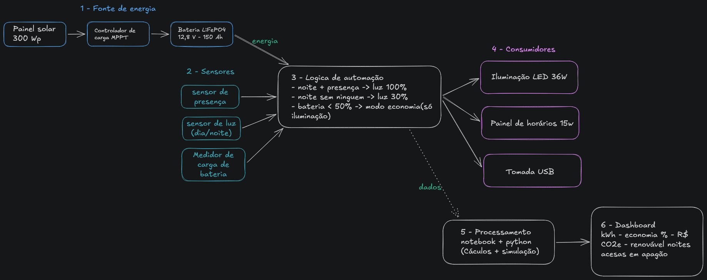
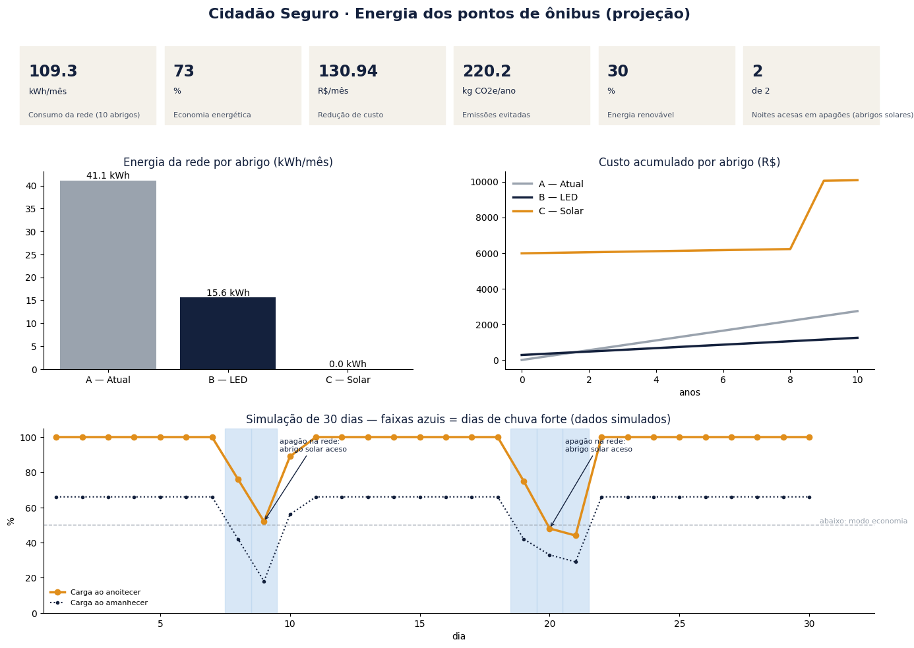

# Cidadão Seguro — Ponto de Ônibus Solar

**Global Solution 2026.2 · Soluções em Energias Renováveis e Sustentáveis (SERS)**
Neighborhood Action Dashboard · Bairro simulado: **Vila Aurora**

## Integrantes

| Nome | RM |
|---|---|
| Valeria Conceição Dos Santos | 574489 |
| Hellen Fabia Assis dos Santos | 575236 |
| Maria Eduarda Laines Braga | 576030 |

Turma: **[1CCPA]**

## Vídeo de apresentação

- Link do video:
- Link do Colab(Dashboard): https://colab.research.google.com/drive/17RWmCTjL2eU2zCG59xFXh-EjwGIhS6ce?usp=sharing
---

## 1. Problema

O **Cidadão Seguro** é o projeto do nosso grupo sobre a segurança da rua: alertas de calor e chuva extremos e problemas como poste apagado, bueiro entupido e alagamento.

Nesta disciplina, olhamos para um lugar do bairro onde a energia faz diferença direta na segurança: **os abrigos de ônibus**. Hoje os 10 abrigos da Vila Aurora usam lâmpadas fluorescentes acesas a noite inteira e dependem só da rede elétrica. Ou seja, eles gastam mais energia do que precisam e **ficam no escuro quando a chuva derruba a energia**, que é justamente quando o passageiro mais precisa de um lugar iluminado.

Isso não é hipotético: em dezembro de 2025, um ciclone extratropical deixou mais de 2 milhões de imóveis sem energia na área da Enel SP.

**Público beneficiado:** quem espera o ônibus à noite, como estudantes, trabalhadores do turno noturno, idosos e pessoas com mobilidade reduzida.

## 2. Solução proposta

Comparamos três alternativas para atender **a mesma necessidade** (iluminar o abrigo das 18h às 6h, manter o painel de horários ligado das 5h às 23h e oferecer uma tomada USB):

| Alternativa | O que muda |
|---|---|
| **A — Atual** | 2 lâmpadas fluorescentes (90 W com reator), acesas a noite toda, ligadas na rede |
| **B — LED com sensor** | 2 tubos LED (36 W) com sensor de presença: 100% com gente e 30% sem ninguém, ainda ligados na rede |
| **C — Solar com bateria** | Mesmo LED com sensor, mas alimentado por painel solar de 300 Wp e bateria de lítio, sem ligação com a rede |

**Nossa proposta é híbrida:** LED com sensor nos 7 abrigos comuns e **kit solar nos 3 abrigos críticos** (em frente à escola, em frente à UBS e na área que alaga). Assim juntamos o menor custo da alternativa B com a resiliência da C nos pontos onde ficar no escuro é mais perigoso.

## 3. Dados utilizados e fontes

| Dado | Valor | Fonte |
|---|---|---|
| Tarifa de iluminação pública (B4a), sem impostos | R$ 0,434/kWh (TUSD 259,83 + TE 174,33 R$/MWh) | Enel SP, Resolução Homologatória ANEEL nº 3.596/2026, válida a partir de 04/07/2026 |
| Fator de emissão da eletricidade | 59,9 kg CO2e/MWh | Balanço Energético Nacional 2025 (ano base 2024) |
| Irradiação solar em São Paulo | 4,5 a 4,8 kWh/m²/dia (usamos 4,0 h de sol pleno, mais conservador) | CRESESB SunData e levantamentos de mercado |
| Taxa de desempenho do sistema solar | 75% | Valor típico da literatura |
| Preço médio da energia solar instalada | cerca de R$ 2,45/Wp (residencial) | Levantamento Solfácil, 2026 |
| Casos reais de abrigos solares | LED + USB alimentados por painel e bateria | Diadema (2021), Sorocaba/Urbes (2022), Ferraz de Vasconcelos (2026) |
| Horários, potências dos equipamentos e número de abrigos | ver notebook | **Premissas do grupo** |

## 4. Cálculos realizados

Usamos a fórmula **E = (P × t) / 1000**, com P em watts, t em horas e E em kWh.

| Equipamento | A — Atual | B e C — LED com sensor |
|---|---|---|
| Iluminação | 90 W × 12 h = 1,08 kWh | 36 W × 6,4 h* = 0,23 kWh |
| Painel de horários | 15 W × 18 h = 0,27 kWh | 15 W × 18 h = 0,27 kWh |
| Tomada USB | 10 W × 2 h = 0,02 kWh | 10 W × 2 h = 0,02 kWh |
| **Total por dia** | **1,37 kWh** | **0,52 kWh** |
| **Total por mês (1 abrigo)** | **41,1 kWh** | **15,6 kWh** |

\* Sensor: 4 h por noite com passageiros (100%) + 8 h sem ninguém (30%) = 6,4 h de uso pleno.

**Dimensionamento do kit solar:**
- Painel: 520 Wh ÷ (4,0 h × 0,75) = 173 Wp mínimos. Escolhemos **300 Wp** para ter folga no inverno.
- Bateria: começamos com 100 Ah, mas na simulação o abrigo ficou no escuro após 3 dias seguidos de chuva. Por isso aumentamos para **150 Ah** (1.536 Wh úteis), o que dá **3 dias de autonomia** sem sol.

## 5. Comparação entre as alternativas (por abrigo)

| | A — Atual | B — LED na rede | C — Solar |
|---|---|---|---|
| Energia da rede | 41,1 kWh/mês | 15,6 kWh/mês | 0 |
| Conta de energia | R$ 17,84/mês | R$ 6,78/mês | R$ 0 |
| Custo de implantação (estimado) | R$ 0 | R$ 280 | R$ 5.980 |
| Emissões | 30,0 kg CO2e/ano | 11,4 kg CO2e/ano | 0 |
| Custo total em 10 anos | R$ 2.741 | **R$ 1.243** | R$ 10.080 |
| Funciona em apagão? | Não | Não | **Sim** |

**Viabilidade técnica:** a B é simples, basta trocar as lâmpadas e instalar um sensor. A C precisa de um teto sem sombra e de proteção contra furto da bateria.
**Impacto ambiental:** a B reduz o consumo em cerca de 62% e elimina o mercúrio das fluorescentes. A C zera o uso da rede, mas a bateria precisa de descarte correto.
**Benefícios e limitações:** pela conta de luz a B vence com folga. A C custa bem mais, mas é a única que mantém o ponto aceso quando a rede cai. Por isso escolhemos a solução híbrida.

## 6. Diagrama de blocos

Fonte de energia (painel → controlador → bateria) → sensores (presença, luz e carga da bateria) → lógica de automação → consumidores (LED, painel e USB) → processamento no notebook → indicadores no dashboard.

**Regras da automação:**
- À noite, com alguém no ponto, a luz fica em 100%.
- À noite, sem ninguém, a luz cai para 30%.
- Com a bateria abaixo de 50% ao anoitecer, o sistema entra em modo economia e desliga o painel e a USB.

## 7. Indicadores (cenário híbrido × situação atual, 10 abrigos)

| Indicador | Resultado |
|---|---|
| Consumo de energia da rede | 411 → **109,3 kWh/mês** |
| Economia energética | **73%** |
| Redução de custo | **R$ 130,94/mês** |
| Emissões evitadas | **220,2 kg CO2e/ano** |
| Participação de energia renovável | **30%** |
| Noites acesas durante apagões (abrigos solares, simulação) | **2 de 2** |

## 8. Código / dashboard

O arquivo [`dashboard_energia.ipynb`](dashboard_energia.ipynb) roda no Google Colab (*Ambiente de execução → Executar tudo*). Ele:
1. lista as premissas com valor, unidade e fonte;
2. calcula o consumo de cada equipamento e de cada alternativa;
3. dimensiona o painel e a bateria;
4. compara custos, emissões e custo em 10 anos;
5. simula 30 dias com chuva e apagões (**dados simulados**);
6. calcula os indicadores e desenha o dashboard.

Para testar outros cenários, basta mudar os valores da célula 2.1 (por exemplo, a tarifa ou o número de abrigos) e rodar de novo.

## 9. Limitações

- Os custos de implantação são **estimativas de ordem de grandeza**, não um orçamento comercial.
- A tarifa usada não inclui impostos; com impostos, a economia em reais seria maior.
- Sombras de prédios ou árvores podem reduzir a geração solar.
- A simulação de 30 dias usa **dados simulados**, e não medições reais.
- As emissões consideram só a operação; a fabricação do painel e da bateria não entra na conta.
- Como a matriz elétrica brasileira já é bastante renovável, o maior ganho ambiental vem da **eficiência (LED + sensor)** e não da troca de fonte. O maior ganho do solar é a **resiliência em apagões**.

> Todas as economias e reduções apresentadas são **projeções** que dependem das premissas acima, e não resultados garantidos.

## 10. Referências

- ANEEL. Resolução Homologatória nº 3.596/2026: Reajuste Tarifário Anual da Enel SP. Tabela de tarifas da Enel SP: https://www.enel.com.br/pt-saopaulo/Para_Voce/tarifa-energia-eletrica.html
- EPE. Balanço Energético Nacional 2025 (ano base 2024): fator de emissão do setor elétrico.
- CRESESB/CEPEL. SunData: potencial solar por localidade. https://cresesb.cepel.br/
- Cenário Energia (2026). Preço do watt-pico residencial recua 7% em um ano. https://cenarioenergia.com.br/2026/06/09/preco-do-watt-pico-residencial-recua-7-em-um-ano-e-abre-janela-de-oportunidade-na-mmgd/
- Diário do Transporte (2021). Diadema recebe o primeiro abrigo de ônibus sustentável com energia solar. https://diariodotransporte.com.br/2021/12/17/diadema-sp-recebe-o-primeiro-abrigo-de-onibus-sustentavel-com-energia-solar/
- Cruzeiro FM (2022). Urbes adota abrigo de ônibus equipado com painel solar. https://www.cruzeirofm.com.br/2022/03/21/noticias/jornalismo/urbes-adota-novo-modelo-de-abrigo-de-onibus-equipado-com-painel-solar/
- Fiscaliza Mogi (2026). Vila São Paulo recebe pontos de ônibus com USB e energia solar. https://www.fiscalizamogi.com/noticia/5061/mogi-das-cruzes/alto-tiete/vila-sao-paulo-recebe-novos-pontos-de-onibus-com-usb-e-energia-solar.html
- Sunlab. Sistema Solarbus para paradas de ônibus (configuração de kits). https://www.sunlab.com.br/Sistemas%20Solarbus.htm
